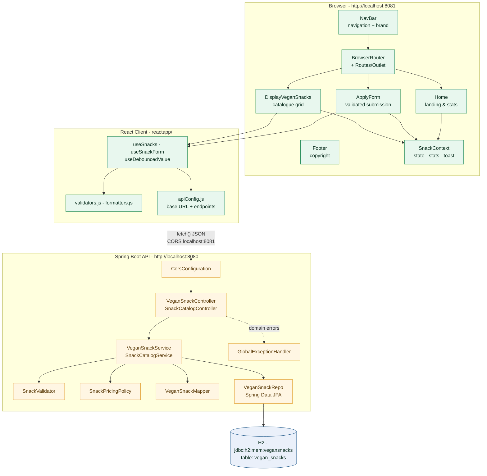
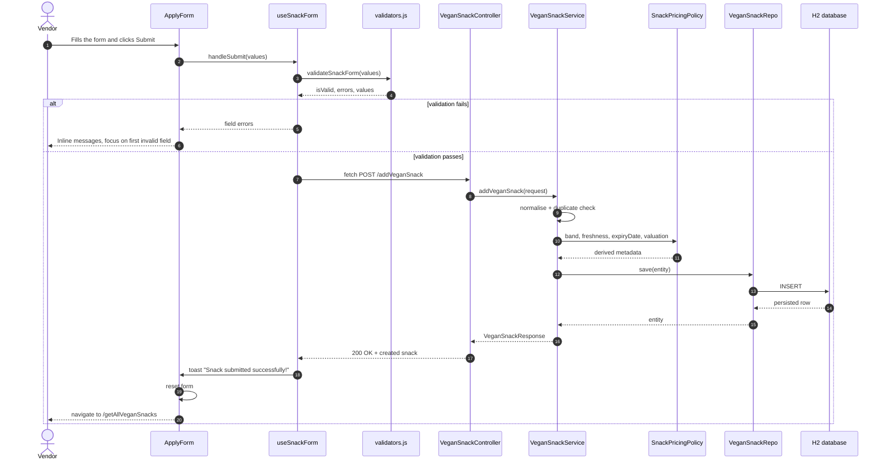
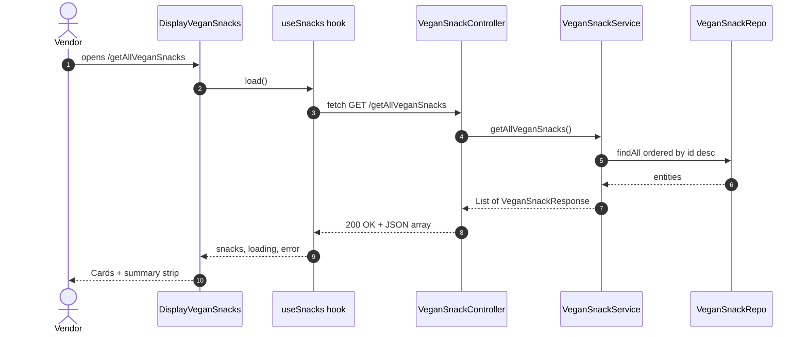
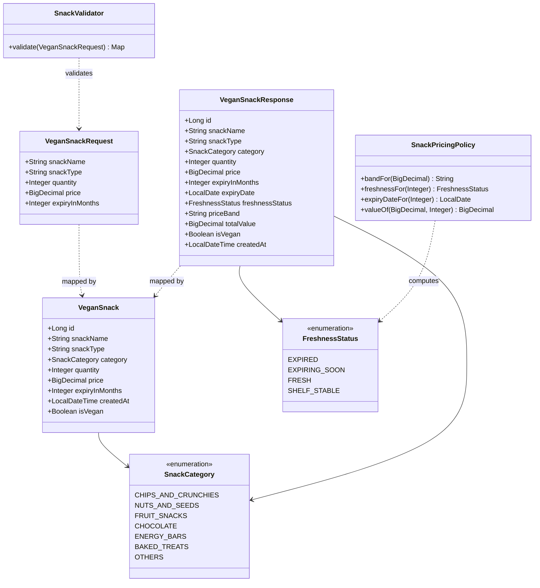
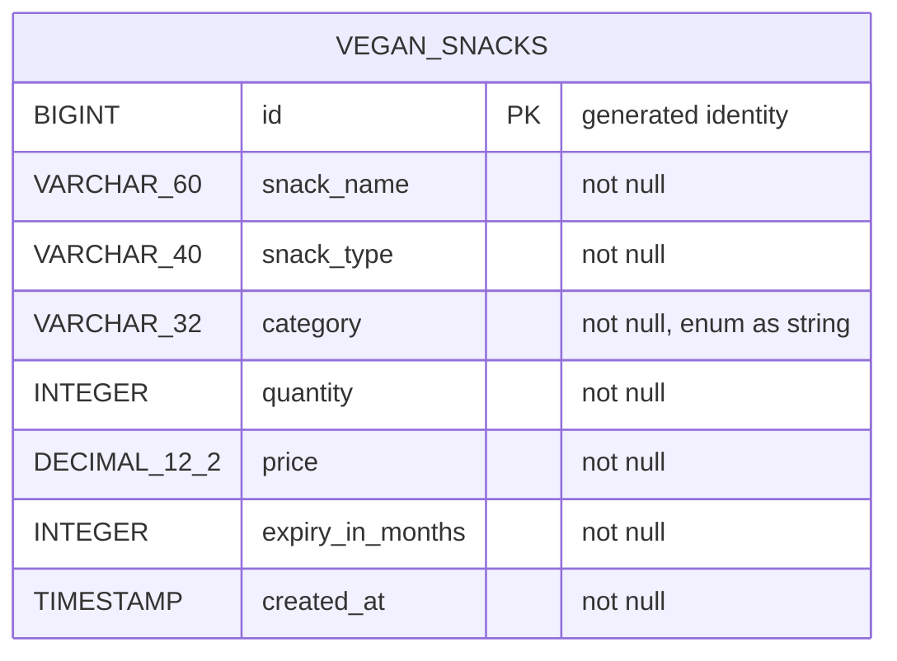

<div align="center">

# 🌱 Vegan Snacks Application

**A full-stack catalogue and submission portal for plant-based snacking.**

[](https://react.dev/)
[](https://spring.io/projects/spring-boot)
[](https://openjdk.org/)
[](https://www.h2database.com/)
[](https://maven.apache.org/)
[](LICENSE)

A single-vendor streaming experience for showcasing vegan snacks. Vendors fill
in a validated online form; the catalogue is persisted, enriched with derived
business metadata and rendered as a responsive, searchable dashboard.

</div>

---

## 📖 Table of Contents

- [Problem Statement](#-problem-statement)
- [Feature Highlights](#-feature-highlights)
- [Technology Stack](#-technology-stack)
- [System Architecture](#-system-architecture)
- [Request Lifecycle](#-request-lifecycle)
- [Domain Model](#-domain-model)
- [Project Structure](#-project-structure)
- [Prerequisites](#-prerequisites)
- [Getting Started](#-getting-started)
- [API Reference](#-api-reference)
- [Validation Rules](#-validation-rules)
- [Design System](#-design-system)
- [Testing](#-testing)
- [Troubleshooting](#-troubleshooting)
- [Contributing](#-contributing)
- [License](#-license)
- [Project Status](#-project-status)

---

## 🎯 Problem Statement

> The **Vegan Snacks Application** is designed to facilitate a streamlined
> process for a single vendor to showcase their vegan snacks. The user-friendly
> application allows the vendor to fill out an online form to submit details
> such as the snack name, price, type, expiration date and quantity. The
> frontend is developed using **React.js** while the backend is built with
> **Spring Boot**, ensuring seamless communication and efficient data handling.

### Functional requirements

| # | Requirement | Where it lives |
|---|-------------|----------------|
| 1 | Landing page welcoming the user with a call to action | `Home.jsx` |
| 2 | Persistent navigation across every route | `NavBar.jsx` |
| 3 | Validated submission form with per-field messages | `ApplyForm.jsx` |
| 4 | Catalogue view listing every submitted snack | `DisplayVeganSnacks.jsx` |
| 5 | `POST /addVeganSnack` — persist a new snack | `VeganSnackController` |
| 6 | `GET /getAllVeganSnacks` — read the whole catalogue | `VeganSnackController` |
| 7 | Copyright footer | `Footer.jsx` |
| 8 | React on **8081**, Spring Boot on **8080** | `.env`, `application.properties` |

---

## ✨ Feature Highlights

**Backend**

- Layered architecture — controller → service → repository → entity, with DTO,
  mapper, exception and utility packages keeping every concern isolated.
- Hand-written validator that reports **every** invalid field in one pass
  instead of stopping at the first failure.
- Domain rules extracted into pure, unit-testable policies: price banding,
  inventory valuation, shelf-life freshness and category resolution.
- A consistent `ApiErrorResponse` envelope for every failure, with per-field
  messages and no stack-trace leakage.
- Duplicate snack names rejected with `409 Conflict`.
- Idempotent catalogue seeding so a fresh boot always shows a populated UI.
- Extra catalog API under `/api/v1/snacks` for search, filtering, statistics
  and health checks.

**Frontend**

- A full landing experience: hero, feature grid, how-it-works strip and live
  catalogue statistics.
- Responsive card-grid catalogue with skeleton loading, an empty state, an
  error state with retry, debounced search, type filtering and multi-key sorting.
- Two-way form validation with live counters, a live preview card and a
  global success toast that survives navigation.
- One design-token layer feeding every stylesheet — colour, radius, elevation
  and type scales.
- Accessibility and responsiveness baked in: semantic landmarks,
  `aria-current` navigation, `aria-invalid` fields, visible focus rings and
  reduced-motion support.

---

## 🛠 Technology Stack

| Layer | Technology | Version | Role |
|-------|------------|---------|------|
| **Frontend** | React | 18.3 | Component runtime |
| | React Router DOM | 6.26 | Client-side routing |
| | Create React App | 5.0.1 | Build toolchain, dev server, test runner |
| | Jest + React Testing Library | 27 / 13 | Unit and interaction tests |
| | Plain CSS (custom properties) | — | Design-token driven styling |
| **Backend** | Spring Boot | 3.2.5 | REST API, auto-configuration, embedded Tomcat |
| | Spring Web MVC | 6.1 | Controllers, JSON binding, CORS |
| | Spring Data JPA / Hibernate | 6.2 | Persistence |
| | H2 Database | 2.2 | Embedded in-memory relational store |
| | Java | 17 | Language level |
| | Maven | 3.9 | Build system |
| **Tooling** | Git & GitHub CLI | — | Version control, releases, repository metadata |

---

## 🏗 System Architecture



---

## 🔁 Request Lifecycle



### Catalogue read path



---

## 🧬 Domain Model





---

## 📂 Project Structure

```text
Vegan-Snacks-Application/
├── CHANGELOG.md                     # Release notes
├── LICENSE                          # MIT licence
├── README.md                        # You are here
│
├── springapp/                       # Spring Boot 3.2.5 - Java 17 - port 8080
│   ├── pom.xml
│   ├── mvnw / mvnw.cmd / .mvn/      # Maven wrapper (no global Maven required)
│   └── src/
│       ├── main/java/com/examly/springapp/
│       │   ├── SpringappApplication.java
│       │   ├── configuration/       # CorsConfiguration, DataSeeder
│       │   ├── controller/          # VeganSnackController, SnackCatalogController
│       │   ├── dto/
│       │   │   ├── request/         # VeganSnackRequest
│       │   │   └── response/        # VeganSnackResponse, SnackCatalogStatsResponse, ApiErrorResponse
│       │   ├── exception/           # InvalidSnackException, DuplicateSnackException,
│       │   │                         # SnackNotFoundException, GlobalExceptionHandler
│       │   ├── mapper/              # VeganSnackMapper
│       │   ├── model/               # VeganSnack, SnackCategory, FreshnessStatus
│       │   ├── repository/          # VeganSnackRepo
│       │   ├── service/             # VeganSnackService, SnackCatalogService
│       │   └── utility/             # SnackValidator, SnackPricingPolicy
│       ├── main/resources/application.properties
│       └── test/java/com/examly/springapp/
│           ├── controller/          # VeganSnackControllerTests
│           └── service/             # VeganSnackServiceTests
│
└── reactapp/                        # React 18.3 - react-router-dom 6.26 - port 8081
    ├── package.json
    ├── .env                         # PORT=8081, HOST=0.0.0.0, BROWSER=none
    ├── public/                      # index.html, favicon.svg, manifest.json, robots.txt
    └── src/
        ├── index.js                 # React entry point
        ├── index.css                # Design tokens + global styles
        ├── setupTests.js
        ├── App.js                   # BrowserRouter + Routes + layout route
        ├── App.css
        ├── apiConfig.js             # Base URL + endpoint map
        ├── assets/                  # logo.svg, leaf-pattern.svg
        ├── components/
        │   ├── NavBar.jsx / .css    # Brand + navigation
        │   ├── Home.jsx / .css      # Landing page
        │   ├── ApplyForm.jsx / .css # Validated submission form
        │   ├── DisplayVeganSnacks.jsx / .css  # Catalogue grid
        │   └── Footer.jsx / .css    # Copyright footer
        ├── context/SnackContext.jsx # Catalogue state, stats, toast channel
        ├── hooks/                   # useSnacks, useSnackForm, useDebouncedValue
        ├── utils/                   # validators.js, formatters.js
        └── tests/App.test.js        # Rendering, routing, validation, submission
```

---

## 📋 Prerequisites

| Requirement | Version | Check |
|-------------|---------|-------|
| JDK | 17+ | `java -version` |
| Maven | 3.8+ *(or use the bundled `mvnw`)* | `mvn -v` |
| Node.js | 16+ | `node -v` |
| npm | 8+ | `npm -v` |

> The database is an **embedded H2 in-memory store** — there is nothing to
> install, configure or migrate. The schema is created automatically on boot.

---

## 🚀 Getting Started

### 1. Clone the repository

```bash
git clone https://github.com/KishoreMuruganantham/Vegan-Snacks-Application.git
cd Vegan-Snacks-Application
```

### 2. Start the backend (port 8080)

```bash
cd springapp
mvn spring-boot:run
```

If Maven is not installed globally, use the bundled wrapper instead:

```bash
cd springapp
./mvnw spring-boot:run        # macOS / Linux
mvnw.cmd spring-boot:run      # Windows
```

You should see:

```
  .   ____          _            __ _ _
 /\\ / ___'_ __ _ _(_)_ __  __ _ \ \ \ \ \
( ( )\___ | '_ | '_ | '_ \/ _` | \ \ \ \ \
 \\/  ___)| |_)| | | | | | (_| |  ) ) ) ) )
  '  |____| .__|_| |_|_| |_\__, | / / / / /
 =========|_|==============|___/=/_/_/_/
 :: Vegan Snacks Application ::  (v1.0.0)

Tomcat started on port 8080 (http) with context path ''
Started SpringappApplication in 2.4 seconds
```

Verify the API:

```bash
curl http://localhost:8080/getAllVeganSnacks
```

### 3. Start the frontend (port 8081)

```bash
cd reactapp
nvm use 16      # optional - Node 16 or newer
npm install
npm start
```

The development server starts on **http://localhost:8081** and prints a
compiled-successfully banner. Open that URL in a browser.

> The port is configured through `reactapp/.env` (`PORT=8081`), so `npm start`
> behaves identically on Windows, macOS and Linux.

### 4. Run both at once

```bash
# terminal 1
cd springapp && mvn spring-boot:run

# terminal 2
cd reactapp && npm start
```

### Build for production

```bash
cd reactapp && npm run build     # -> reactapp/build (static assets)
cd springapp && mvn clean package # -> springapp/target/springapp.jar
java -jar springapp/target/springapp.jar
```

---

## 🔌 API Reference

Base URL `http://localhost:8080` · All payloads are JSON ·
`Content-Type: application/json`

### Core endpoints (mandated by the problem statement)

| Method | Endpoint | Description | Success |
|--------|----------|-------------|---------|
| `GET` | `/getAllVeganSnacks` | List every snack, newest first | `200` + array |
| `POST` | `/addVeganSnack` | Register a new snack | `200` + created snack |

<details>
<summary><strong>Response shape</strong> — <code>VeganSnackResponse</code></summary>

```json
{
  "id": 1,
  "snackName": "Roasted Almonds",
  "snackType": "Nuts and Seeds",
  "category": "NUTS_AND_SEEDS",
  "quantity": 25,
  "price": 149.50,
  "expiryInMonths": 6,
  "expiryDate": "2027-05-13",
  "freshnessStatus": "FRESH",
  "priceBand": "STANDARD",
  "totalValue": 3737.50,
  "isVegan": true,
  "createdAt": "2026-11-13T05:20:31.123"
}
```

</details>

<details>
<summary><strong>Error shape</strong> — <code>ApiErrorResponse</code></summary>

```json
{
  "timestamp": "2026-11-13T05:22:10.482",
  "status": 400,
  "error": "Bad Request",
  "message": "Snack details are invalid.",
  "fieldErrors": {
    "price": "Price must be a positive number",
    "expiryInMonths": "Expiry must be a non-negative number"
  }
}
```

</details>

### Catalog endpoints

| Method | Endpoint | Description |
|--------|----------|-------------|
| `GET` | `/api/v1/snacks` | List with optional `?search=` and `?type=` filters |
| `GET` | `/api/v1/snacks/{id}` | Fetch a single snack |
| `PUT` | `/api/v1/snacks/{id}` | Update a snack |
| `DELETE` | `/api/v1/snacks/{id}` | Remove a snack |
| `GET` | `/api/v1/snacks/stats` | Catalogue statistics and per-category breakdown |
| `GET` | `/api/v1/health` | Liveness probe with the current catalogue size |

### Examples

```bash
# Create
curl -X POST http://localhost:8080/addVeganSnack \
  -H "Content-Type: application/json" \
  -d '{"snackName":"Roasted Almonds","snackType":"Nuts and Seeds","quantity":25,"price":149.50,"expiryInMonths":6}'

# Read
curl http://localhost:8080/getAllVeganSnacks

# Statistics
curl http://localhost:8080/api/v1/snacks/stats

# Health
curl http://localhost:8080/api/v1/health
```

---

## 🧾 Validation Rules

The same rules are enforced on both sides of the wire — the React form gives
instant feedback, and the API independently rejects anything invalid.

| Field | Rule | Message |
|-------|------|---------|
| `snackName` | Required | `Snack Name is required` |
| | 2 – 60 characters | `Snack Name must be between 2 and 60 characters` |
| | Letters, digits, spaces and `& ' , / + - % _ # : . ( )` | `Snack Name contains unsupported characters` |
| | Unique (case-insensitive) | `A snack with this name already exists` |
| `snackType` | Required | `Snack Type is required` |
| | Max 40 characters | `Snack Type must be 40 characters or less` |
| `quantity` | Required | `Quantity is required` |
| | ≥ 1 | `Quantity must be at least 1` |
| | ≤ 100 000 | `Quantity must be 100000 or less` |
| `price` | Required | `Price is required` |
| | > 0 | `Price must be a positive number` |
| | ≤ 1 000 000 | `Price must be 1000000 or less` |
| | Max 2 decimal places | `Price must have at most 2 decimal places` |
| `expiryInMonths` | Required | `Expiry in months is required` |
| | ≥ 0 | `Expiry must be a non-negative number` |
| | ≤ 120 | `Expiry must be 120 months or less` |

### Derived metadata

| Rule | Result |
|------|--------|
| Price band | `< 100` → `BUDGET` · `100 – 499.99` → `STANDARD` · `500 – 1999.99` → `PREMIUM` · `≥ 2000` → `ARTISAN` |
| Freshness | `0` months → `SHELF_STABLE` · `1 – 2` → `EXPIRING_SOON` · `3 – 11` → `FRESH` · `≥ 12` → `SHELF_STABLE` |
| Expiry date | Today + `expiryInMonths` calendar months |
| Total value | `price × quantity`, rounded to 2 decimals |
| Category | Keyword match against the snack type → `SnackCategory` |

---

## 🎨 Design System

A single token layer in `reactapp/src/index.css` drives every component.

| Token group | Values |
|-------------|--------|
| Greens | `--green-950` `--green-900` `--green-800` `--green-700` `--green-600` |
| Accents | `--leaf-500` `--leaf-400` `--lime-300` `--amber-400` `--amber-500` |
| Neutrals | `--cream-50` `--cream-100` `--cream-200` `--ink-900` `--ink-700` `--ink-600` `--ink-400` |
| Radii | `--radius-sm` `10px` · `--radius-md` `14px` · `--radius-lg` `20px` · `--radius-xl` `28px` · `--radius-pill` |
| Elevation | `--shadow-sm` · `--shadow-md` · `--shadow-lg` |
| Type | `--font-body` Inter · `--font-display` Outfit (with full local fallbacks) |

The palette is a warm cream page with deep-green ink, leaf and lime accents,
hairline borders and layered soft shadows. Everything is fluid via `clamp()`,
and every animation respects `prefers-reduced-motion`.

---

## 🧪 Testing

### Backend — JUnit 5 + MockMvc

```bash
cd springapp
mvn test
```

Covers the validator rules, the pricing policy, category resolution, duplicate
detection, statistics aggregation and the full controller contract.

### Frontend — Jest + React Testing Library

```bash
cd reactapp
CI=true npm test -- --watchAll=false
```

Covers Home rendering, navigation, the Apply form and its validation
messages, the submit round trip and the footer copyright.

---

## 🩺 Troubleshooting

| Symptom | Cause | Fix |
|---------|-------|-----|
| `Port 8080 was already in use` | Backend already running | Stop the other process, or change `server.port` |
| `Port 8081 was already in use` | Dev server already running | Stop the other process, or change `PORT` in `reactapp/.env` |
| `ECONNREFUSED` in the browser | Backend is not running | Start `mvn spring-boot:run` in `springapp` |
| CORS error in the console | Client port differs from 8081 | Add your origin to `CorsConfiguration` |
| `npm start` fails with an OpenSSL error | Node 17+ with an old webpack | `export NODE_OPTIONS=--openssl-legacy-provider` (or use Node 16) |
| Blank page after a code change | Stale dev cache | `rm -rf node_modules && npm install` |

---

## 🤝 Contributing

1. Fork the repository and create a topic branch.
2. Keep the layering intact — controllers stay thin, business rules live in the
   service and utility packages.
3. Match the existing naming conventions and the design tokens.
4. Run both test suites before opening a pull request.
5. Update `CHANGELOG.md` under the *Unreleased* heading.

---

## 📄 License

Released under the [MIT License](LICENSE).

```text
Copyright (c) 2024 Kishore Muruganantham
```

---

## 📊 Project Status

| Area | Coverage |
|------|----------|
| Problem statement | Fully implemented — every mandated route, label, message and endpoint |
| Backend endpoints | 2 contract endpoints + 6 catalog endpoints, all covered by tests |
| Backend tests | 51 JUnit tests, 0 failures |
| Frontend tests | 8 React Testing Library tests, 0 failures |
| Accessibility | Semantic landmarks, `aria-current`, `aria-invalid`, focus rings, reduced motion |
| Responsiveness | Verified from 360px to 1440px, no horizontal overflow |
| Build | `mvn package` and `npm run build` both compile with zero warnings |

### Release history

| Version | Date | Summary |
|---------|------|---------|
| `v1.1.0` | 2026-11-13 | Layered backend rebuild, redesigned client, docs and CI — [changelog](CHANGELOG.md) |
| `v1.0.0` | 2026-11-13 | Initial working implementation of the problem statement |

### Possible next steps

- Persist the catalogue to MySQL instead of the embedded H2 store.
- Vendor accounts with authentication instead of the single-vendor model.
- Catalogue export to CSV for the vendor's own records.

---

<div align="center">

**Built with React and Spring Boot by Kishore Muruganantham**

</div>

